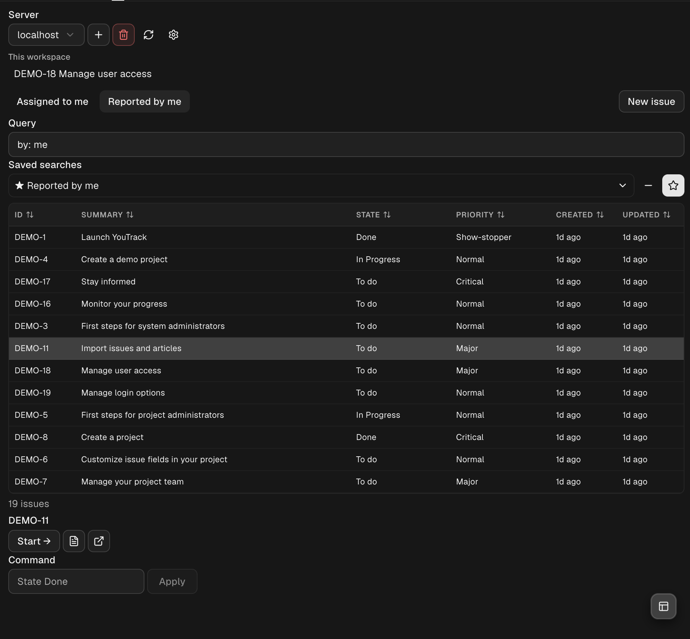
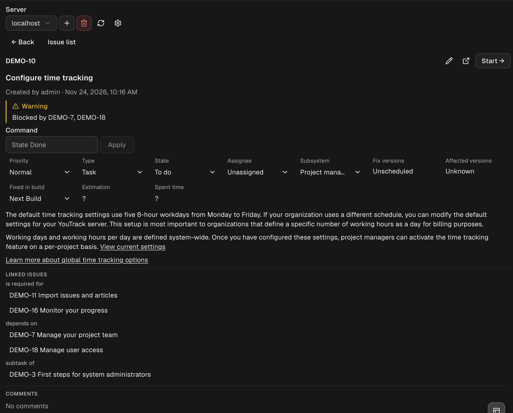
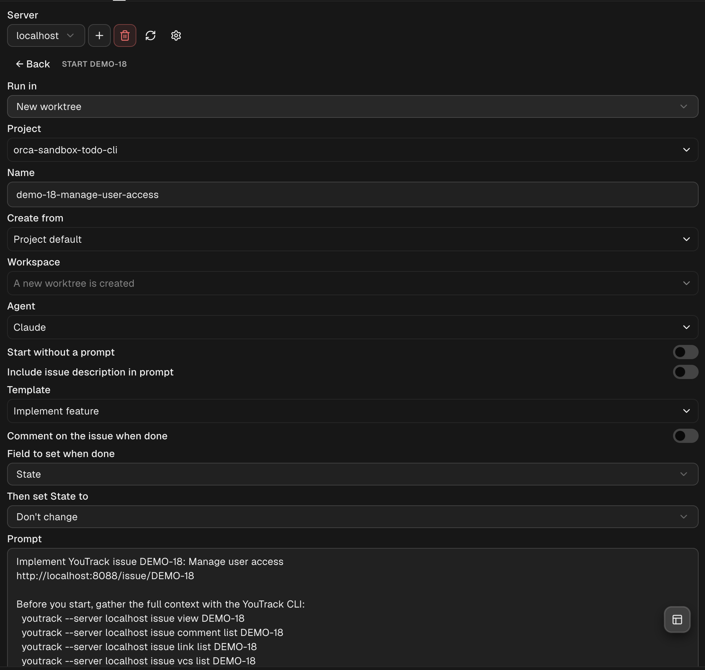
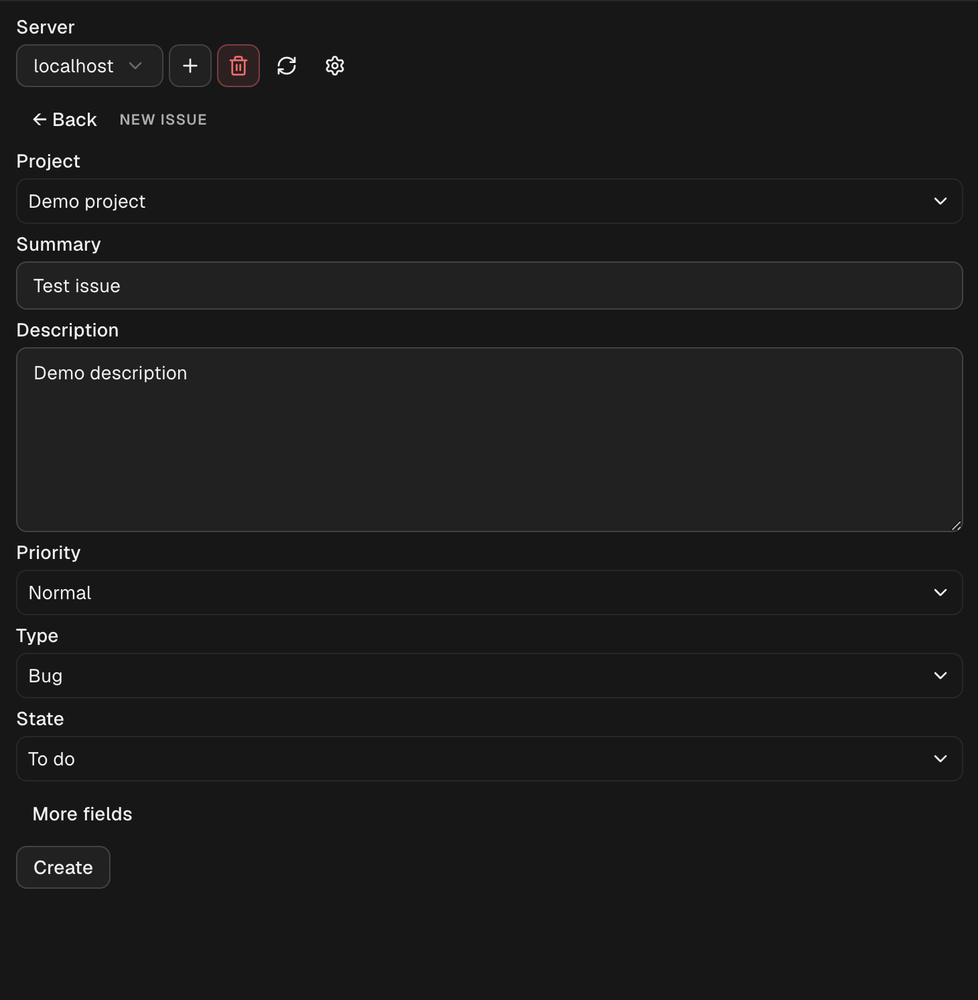

# YouTrack for Orca

An Orca plugin that shows your YouTrack issues in the right sidebar and starts a coding agent on any
of them: in a new worktree or in the workspace you are in, with a prompt built from the issue.

This is an unofficial plugin.

| Issue details | Start work on an issue | New issue |
| --- | --- | --- |
|  |  |  |

## Install

Any of these, then approve the access the plugin asks for (see [Permissions](#permissions)):

- **From the plugin directory:** [Open in Orca](https://onorca.dev/plugins/maxfedorov.youtrack-for-orca?catalog=community)
  from the [Orca plugin directory](https://onorca.dev/plugins).
- **In Orca:** Settings → Plugins → **Add plugin** → **From a Git URL…** with
  `https://github.com/maxfedorov/youtrack-for-orca`, or **From a folder…** with a local clone of it.
- **From a terminal** (Orca 1.4.252 or newer):

      orca plugin install maxfedorov.youtrack-for-orca --catalog community

  Orca lists the access the plugin asks for and prints a fingerprint; run the command again with
  `--approve <fingerprint>` to install.

**Update:** updates from the catalog install by themselves unless they ask for new access; to update
now, run `orca plugin update maxfedorov.youtrack-for-orca`. **Remove:** Settings → Plugins, or
`orca plugin uninstall maxfedorov.youtrack-for-orca`, which also deletes what the plugin saved.

## Quick start

1. **Open the panel:** the YouTrack tab in Orca's right sidebar, the `YT` item in the status bar, or
   "YouTrack: Open panel" in the command palette. If the YouTrack CLI is missing, the panel shows the
   command that installs it.
2. **Add your server:** enter its address (such as `https://youtrack.example.com`) and press
   **Add server**, then sign in in the browser. If that does not work, use the terminal command the
   panel shows. More servers: the **+** next to the server choice.
3. **Find issues:** type a YouTrack query (`for: me #Unresolved`, `project: ABC State: Open`) and press
   Enter, or choose a saved search. Press a column header to sort. Double-click a row, or press the
   details button, to see the issue with its fields, links and comments.
4. **Start work:** select an issue and press **Start →**. Choose a new worktree (project, name, base
   branch) or the current workspace, the agent and the prompt template, check the prompt, and press
   **Start**. Orca creates the worktree and starts the agent there; the issue then offers **Open →**,
   and you get a notification when the agent finishes.
5. **Tune it:** Orca's Settings → Plugins → YouTrack for Orca holds the defaults (query, columns,
   branch name, agent, where to run, prompt options), each with a Reset once changed. The gear in the
   panel manages prompt templates and each server's default Orca project, and resets all the settings
   at once.

## Requirements

- Orca 1.4.248 or newer.
- The [YouTrack CLI](https://github.com/JetBrains/youtrack-cli) (`youtrack`) 1.0.0 or newer: install it as
  described in [its README](https://github.com/JetBrains/youtrack-cli#install). With an older CLI the
  issues and Start work, but changing fields, the new-issue form and the when-done field in Start do not;
  the panel offers the update.

- A YouTrack server known to the CLI. Add one with `youtrack auth login <url>`, or in the panel
  ("Add a YouTrack server"), which signs you in through the browser. If browser sign-in fails, or you
  choose **Sign in from a terminal instead**, the panel shows the `youtrack auth login` command to run in
  your own terminal; then press **I've signed in**. A signed-out server offers **Sign in again** the same
  way. The CLI asks for a permanent token there and keeps it; the plugin never sees it.

If the CLI is missing, the panel links to its install instructions.

Tested on macOS. Linux and Windows are supported (the CLI paths and shims of each are handled) but have
seen less use.

## Features

- Issue list for a YouTrack search query, with your saved searches in a drop-down. The ones you starred
  in YouTrack come first, marked ★.
- **Quick views**: saved searches you choose show as buttons above the query, one press each. Choose a
  saved search, then press **+** next to the drop-down to add it, or **−** to take it off (up to 12 per
  server).
- **This workspace**: the issue of the focused workspace shows above the list, one press from its
  details: the issue the plugin started there, or the one its branch is named after (`demo-42-fix`,
  `feature/DEMO-42`). A workspace whose branch names an issue of one of the server's projects also gives
  that issue **Open →**, even when the plugin did not create it (unless it was started for another server).
- Star button (☆) to save the current query as a saved search.
- Columns sort when you press their header. After ID and Summary come the columns of the *Issue list
  columns* setting, in its order: custom fields and the Created and Updated dates (State, Priority,
  Assignee, Created, Updated unless you change it); a field no issue in the list has is left out.
  Refresh, or changing the server, reloads the list.
- Issue details: who created the issue and when, tags, fields, description and comments. Open
  blockers ("depends on") are named at the top, one press from their details, and subtasks show how
  many are done. The × in a tag removes it from the issue.
- **Change fields**: the fields sit in a grid as wide as the panel. Press the value of a single-value
  list field (State, Priority, Assignee, versions, subsystems, builds and others) to pick from the values
  YouTrack lets you set on that issue; the choice is saved at once. "No value" empties a field that may
  be empty. String, whole-number and period fields (such as `2h 30m`) open an input when you press their
  value: type a new one and press Enter, empty it to clear the field, or press × to leave it as it
  was. Multi-value, text, float and date fields show their value and are changed with a command; a long
  value stays on one line, and the ⓘ next to it shows the whole text. A State moved by a workflow state
  machine has no list of values to pick from, so its drop-down asks for a command too. Without
  permission to change the issue, the panel says so.
- **Edit** the summary and the description of an issue (the pencil next to its id).
- **Articles**: the **Articles** tab next to **Issues** shows the knowledge base of a project as a tree,
  each article with its id under the title. Choose the project; an article with sub-articles opens with
  its arrow, and its sub-articles are read when it first opens. Type in the search field and press
  Enter to find articles of the project, or press the star next to it for the ones you starred in
  YouTrack (it lights up while it is on); the two combine, and found articles show their parent after
  the id. Pressing an article opens it: the path of its parent articles, who created it and changed it
  last, its content, sub-articles, the articles and issues it mentions, attachment names and comments,
  where you can add one. Mentioned articles and issues open inside the panel, and Back walks back the
  way you came. An issue that mentions articles lists them under **Articles**.
- **Send to agent**: in an article, asks an agent open in the focused workspace to read it. The button
  types one line into the agent's terminal — `Read this YouTrack article for context:` and the
  `youtrack article view <ID>` command — without pressing Enter, so you can check it and send it
  yourself. With several agents, choose which one first.
- **New issue**: choose the project, write the summary and description, and set its fields; the
  required ones come first, with the defaults YouTrack fills in. The form works on a YouTrack draft, like
  YouTrack's own New issue: Create submits it, Back deletes it. A project where you cannot create
  issues says so. The new issue opens when it is created.
- **Apply command**: run a YouTrack command such as `State Done` on the selected issue or the open
  detail. It runs only when you press Apply or Enter.
- **Add comment**: write a comment in the issue detail and press Send (or Cmd+Enter, Ctrl+Enter off macOS);
  it gets the server's default visibility. Applying a command, adding a comment, changing a field,
  removing a tag, editing or creating an issue, commenting on an article and saving a search are the
  plugin's only YouTrack writes, and each runs only when you press its button or choose a value.
- **Start**: choose **Run in** (New worktree or Current workspace); for a new worktree the project,
  the name of the new workspace and branch, and the branch to create it from ("Create from"), otherwise
  the workspace; and the agent. Then either **Start without a prompt** (the agent waits for you in its
  terminal), or build the prompt: include the issue description or not, pick a template, and edit or
  clear the prompt (up to 4096 characters) before it is sent.
- **Articles as context**: when the issue mentions knowledge base articles, "Include mentioned articles"
  in Start adds a short paragraph to the end of the prompt asking the agent to read each of them with
  `youtrack --server <server> article view <ID>`. It holds only the article ids, never their text.
- **When the agent finishes**: in Start, "Comment on the issue when done" and "Then set State to"
  add steps at the end of the prompt, so the agent adds a comment that sums up its work and sets the
  field to the value you chose, with the YouTrack CLI. The field is the issue's own (State, Stage,
  Status, ...): when the issue has more than one single-value state or enum field, "Field to set when
  done" chooses it. The field and value you start with are offered first next time for that YouTrack
  project.
- **Skill for coding agents** (the gear): installs or updates the YouTrack CLI's skill for every coding
  agent found on your computer (`youtrack skill update`), so agents know how to read and update issues.
- **YouTrack CLI updates**: when a newer YouTrack CLI release is out, a download button appears in
  the header. It opens a note with both versions: **Update** runs `youtrack update --yes`, which
  upgrades the CLI the way it was installed; for installs it cannot upgrade (such as apt or rpm), the
  note shows what to run yourself. **What's new** opens the release page, and **Skip this version**
  hides the button until the next release. The check runs `youtrack update --json` when the panel opens,
  at most once a day; builds from source are not checked.
- **Prompt templates** (the gear button, "Prompt templates and servers"): named templates for the prompt. Five come built in —
  Implement feature, Investigate and fix bug, Cover with automated tests, Review and plan (no code
  changes), Refactor safely. Create, edit, delete and choose the default (up to 30 templates, 8000
  characters each); "Restore built-in templates" puts the five back without touching your own.
- **Project memory**: Start remembers the Orca project you chose for each YouTrack project (per server)
  and offers it next time. Otherwise it offers the server's default project, set in the settings view
  under Servers, and then the project of the current workspace.
- **Remove server**: the bin button next to the server choice removes the server from the YouTrack CLI
  (which signs the CLI out of it) after you confirm, and forgets what the plugin saved for it.
- Status bar item with the number of issues matching the panel's current query on the selected server
  (`YT: 13`); `YT: !` means signed out, `YT: ?` a query that does not parse, `YT: –` a server that
  cannot be reached. The tooltip says why. It is counted when Orca starts the plugin and after searches
  and changes in the panel, never on a timer, so the plugin sends no requests while you do not use it.
- Desktop notification when an agent started from an issue finishes.
- Command palette: "YouTrack: Open panel".

## Permissions

| Permission           | Used for                                                                                 |
| -------------------- | ---------------------------------------------------------------------------------------- |
| `settings:own`       | Reading the plugin's settings below.                                                     |
| `storage:own`        | The chosen server, the last query and the quick views of each server, prompt templates, which workspace was started for which issue, the project and when-done field and value remembered for each YouTrack project, the project whose articles were shown last on each server, and the last YouTrack CLI update check and a skipped release. |
| `workspace:read`     | Listing workspaces for Start and Open, finding the focused one and the issue its branch names, and forgetting links to removed workspaces. |
| `workspace:write`    | The Open button (switches to the issue's workspace) and opening the right sidebar.        |
| `agent:read`         | Noticing when an agent started from an issue has finished, and listing the agents of the focused workspace for Send to agent. |
| `agent:launch`       | Starting an agent in the current workspace when the Orca CLI cannot.                     |
| `notifications:show` | The "Agent finished" notification.                                                       |
| `terminal:send`      | Send to agent: types one line into an agent's terminal in the focused workspace, asking it to read an article with `youtrack article view <ID>`. It holds only the server alias and the article id, and Enter is left to you. |

The plugin runs a Node.js worker on your machine with your user account's access (`trusted-worker`),
because it starts the `youtrack` and `orca` command-line tools.

## What the plugin runs

Only two programs, always with an argument list and never through a shell:

- `youtrack`, to read issues, comments, projects, saved searches and knowledge base articles, save a
  search, apply a command, add a comment to an issue or an article, change a field, remove a tag, edit and create issues, install the agent skill, check
  for and install a newer YouTrack CLI, add a server through the browser and remove a server. Fields
  come from `youtrack issue field list` and their values from `youtrack issue field list-values`, so
  each user sees what YouTrack lets them pick; no admin rights are needed;
- `orca`, to list projects and branches, create worktrees and launch agents.

Articles are read with `youtrack raw` on `/api/articles` (`youtrack article list` prints the whole
text of every article), a page of 500 at a time.

The plugin makes no network requests of its own, stores no tokens and collects no data about you;
everything that talks to YouTrack goes through the CLI. So does the update check: the CLI asks
GitHub for its latest release.

## Security notes

- The plugin works through the YouTrack CLI and the token you signed it in with. The CLI keeps the
  token; the plugin never sees it.
- An agent that has shell access can run `youtrack` and so use the CLI's stored credentials. Start agents
  only where that is acceptable, and review the prompt before sending it.
- Issue text and comments are untrusted input. The built-in templates tell the agent to treat them as
  data, not instructions. The description goes into the prompt only when the switch is on or the
  template contains `{{description}}`, and always inside a block marked untrusted.
- Send to agent and "Include mentioned articles" pass on only the server alias and article ids, in a
  `youtrack article view` command; an article's title and text never reach the agent's terminal or the
  prompt. Send to agent types into a terminal only after checking that an agent of the focused
  workspace runs there, and never presses Enter.
- The "when the agent finishes" steps are written by the plugin from the issue id, the server alias
  and names from the project's own value lists, each in single quotes; only names made of letters,
  digits, spaces and `_ . -` are offered.

## Settings

| Setting                 | Default                                | Meaning                                                                 |
| ----------------------- | -------------------------------------- | ----------------------------------------------------------------------- |
| Default query           | `for: me #Unresolved`                  | Query used on first open of each server.                                 |
| Issue list columns      | `State, Priority, Assignee, Created, Updated` | Columns after ID and Summary, separated by commas (at most 10): custom fields such as `Fix versions`, and `Created` or `Updated`. |
| Branch name template    | `{{id_lower}}-{{summary_slug}}`        | Name of the new workspace and branch.                                   |
| Default agent           | `claude`                               | Agent id (for example `claude`, `codex`) preselected in the Start view; empty means no agent, terminal only. |
| Default launch mode     | New worktree                           | "Run in" choice preselected in the Start view: `New worktree` or `Current workspace`. |
| Start agents without a prompt | off                              | Initial state of the "Start without a prompt" switch in the Start view. |
| Include issue description | off                                  | Initial state of the switch in the Start view.                          |
| Include mentioned articles | on                                  | Initial state of the "Include mentioned articles" switch in the Start view: the prompt asks the agent to read the articles the issue mentions. |
| Agent comments when done | off                                   | Initial state of "Comment on the issue when done" in the Start view.    |
| State when done         | empty                                  | Values that "Then set State to" offers first, separated by commas, such as `In Review, Review`: the first one the field has is chosen. A choice made in Start for a YouTrack project wins there. |
| YouTrack CLI path       | empty (auto-detect)                    | Full path to the `youtrack` executable if it is not found.              |

Placeholders for the prompt templates and the branch name template: `{{id}}`, `{{id_lower}}`, `{{summary}}`,
`{{summary_slug}}`, `{{url}}`, `{{project}}`, `{{server}}`, `{{state}}`, `{{priority}}`, `{{assignee}}`,
`{{description}}`, `{{branch}}`.

## Troubleshooting

- **"Install YouTrack CLI" although it is installed:** set *YouTrack CLI path* in the plugin settings
  to the full path of `youtrack`, then press Check again.
- **"Orca CLI not found — new worktrees are unavailable":** the `orca` command that ships with Orca was
  not found; Start can still run an agent in the current workspace.
- **Signed out (`YT: !`):** press **Sign in again** in the panel and follow the steps.
- **`YT: ?`:** the current query does not parse; fix it in the panel. **`YT: –`:** the server cannot be
  reached; the tooltip says why.

## Tip

Run `youtrack skill install` to give your agents the CLI's own skill, so they know how to use `youtrack`
beyond the commands in the prompt.

## Development

No build step and no dependencies: the panel is TSX that Orca loads as it is, and the worker is plain
JavaScript modules.

    orca plugin dev load ./     # load this folder into Orca and reload on changes
    orca plugin test ./         # unit and panel tests
    orca plugin check ./        # type-check and render the panel scenarios
    orca plugin validate ./     # manifest and file checks

GitHub Actions runs the tests and the manifest checks on every pull request and on `main`
(`.github/workflows/test.yml`), with the test runtime and validator of the Orca release named there.

## License

[MIT](LICENSE)
