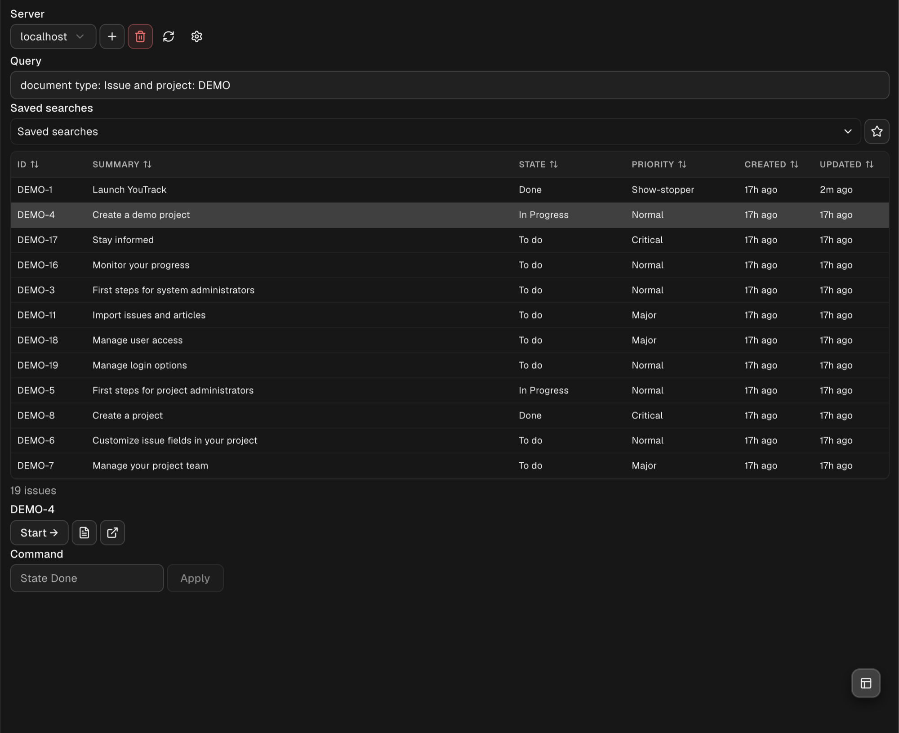
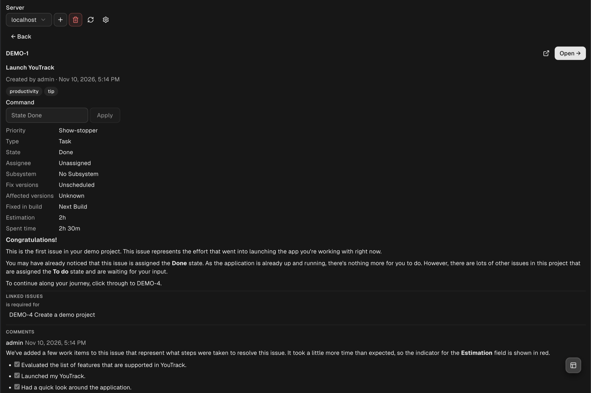
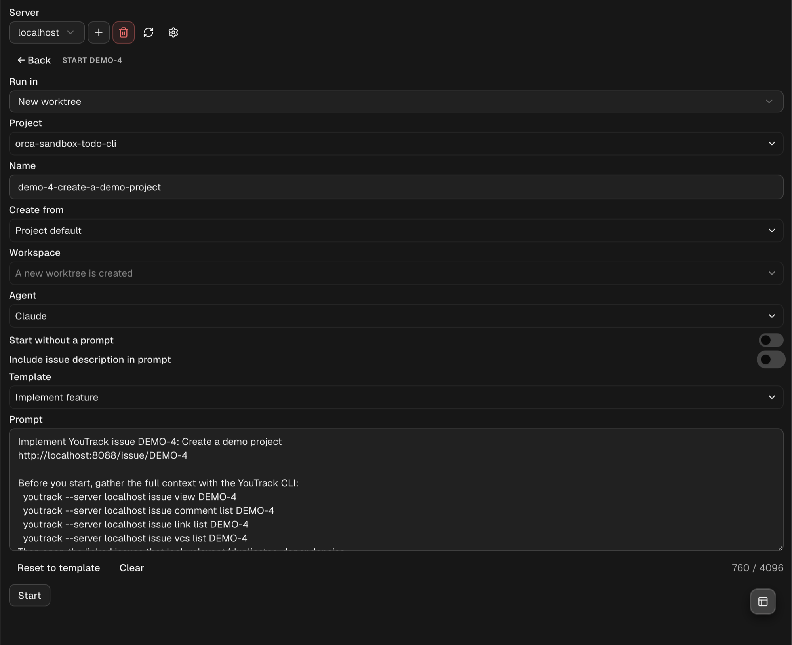

# YouTrack for Orca

An Orca plugin that shows your YouTrack issues in the right sidebar and starts a coding agent on any
of them: in a new worktree or in the workspace you are in, with a prompt built from the issue.

This is an unofficial plugin.

| Issue details | Start work on an issue |
| --- | --- |
|  |  |

## Install

Any of these, then approve the access the plugin asks for (see [Permissions](#permissions)):

- **From the plugin directory:** [Open in Orca](https://onorca.dev/plugins/maxfedorov.youtrack-for-orca?catalog=community)
  from the [Orca plugin directory](https://onorca.dev/plugins).
- **In Orca:** Settings → Plugins → **Add plugin** → **From a Git URL…** with
  `https://github.com/maxfedorov/youtrack-for-orca`, or **From a folder…** with a local clone of it.
- **From a terminal** (Orca 1.4.252 or newer):

      orca plugin install maxfedorov.youtrack-for-orca --catalog community

  Orca lists the access the plugin asks for and prints a fingerprint; run the command again with
  `--approve <fingerprint>` to install.

**Update:** updates from the catalog install by themselves unless they ask for new access; to update
now, run `orca plugin update maxfedorov.youtrack-for-orca`. **Remove:** Settings → Plugins, or
`orca plugin uninstall maxfedorov.youtrack-for-orca`, which also deletes what the plugin saved.

## Quick start

1. **Open the panel:** the YouTrack tab in Orca's right sidebar, the `YT` item in the status bar, or
   "YouTrack: Open panel" in the command palette. If the YouTrack CLI is missing, the panel shows the
   command that installs it.
2. **Add your server:** enter its address (such as `https://youtrack.example.com`) and press
   **Add server**, then sign in in the browser. If that does not work, use the terminal command the
   panel shows. More servers: the **+** next to the server choice.
3. **Find issues:** type a YouTrack query (`for: me #Unresolved`, `project: ABC State: Open`) and press
   Enter, or choose a saved search. Press a column header to sort. Double-click a row, or press the
   details button, to see the issue with its fields, links and comments.
4. **Start work:** select an issue and press **Start →**. Choose a new worktree (project, name, base
   branch) or the current workspace, the agent and the prompt template, check the prompt, and press
   **Start**. Orca creates the worktree and starts the agent there; the issue then offers **Open →**,
   and you get a notification when the agent finishes.
5. **Tune it:** Orca's Settings → Plugins → YouTrack for Orca holds the defaults (query, columns,
   branch name, agent, where to run, prompt options), each with a Reset once changed. The gear in the
   panel manages prompt templates and each server's default Orca project, and resets all the settings
   at once.

## Requirements

- Orca 1.4.248 or newer.
- The [YouTrack CLI](https://github.com/JetBrains/youtrack-cli) (`youtrack`):

  | OS            | Install                                   |
  | ------------- | ----------------------------------------- |
  | macOS / Linux | `brew install jetbrains/utils/youtrack`   |
  | Windows       | `winget install JetBrains.YouTrackCLI`    |

- A YouTrack server known to the CLI. Add one with `youtrack auth login <url>`, or in the panel
  ("Add a YouTrack server"), which signs you in through the browser. If browser sign-in fails, or you
  choose **Sign in from a terminal instead**, the panel shows the `youtrack auth login` command to run in
  your own terminal; then press **I've signed in**. A signed-out server offers **Sign in again** the same
  way. The CLI asks for a permanent token there and keeps it; the plugin never sees it.

If the CLI is missing, the panel shows the install command for your system to run in a terminal.

Tested on macOS. Linux and Windows are supported (the CLI paths and shims of each are handled) but have
seen less use.

## Features

- Issue list for a YouTrack search query, with your saved searches in a drop-down.
- Star button (☆) to save the current query as a saved search.
- Columns sort when you press their header. After ID and Summary come the columns of the *Issue list
  columns* setting, in its order: custom fields and the Created and Updated dates (State, Priority,
  Assignee, Created, Updated unless you change it); a field no issue in the list has is left out.
  Refresh, or changing the server, reloads the list.
- Issue details: who created the issue and when, tags, fields, description and comments.
- **Apply command**: run a YouTrack command such as `State Done` on the selected issue or the open
  detail. It runs only when you press Apply or Enter.
- **Add comment**: write a comment in the issue detail and press Send (or Cmd+Enter, Ctrl+Enter off macOS);
  it gets the server's default visibility. Applying a command, adding a comment and saving a search are
  the plugin's only YouTrack writes.
- **Start**: choose **Run in** (New worktree or Current workspace); for a new worktree the project,
  the name of the new workspace and branch, and the branch to create it from ("Create from"), otherwise
  the workspace; and the agent. Then either **Start without a prompt** (the agent waits for you in its
  terminal), or build the prompt: include the issue description or not, pick a template, and edit or
  clear the prompt (up to 4096 characters) before it is sent.
- **Prompt templates** (the gear button, "Prompt templates and servers"): named templates for the prompt. Five come built in —
  Implement feature, Investigate and fix bug, Cover with automated tests, Review and plan (no code
  changes), Refactor safely. Create, edit, delete and choose the default (up to 30 templates, 8000
  characters each); "Restore built-in templates" puts the five back without touching your own.
- **Project memory**: Start remembers the Orca project you chose for each YouTrack project (per server)
  and offers it next time. Otherwise it offers the server's default project, set in the settings view
  under Servers, and then the project of the current workspace.
- **Remove server**: the bin button next to the server choice removes the server from the YouTrack CLI
  (which signs the CLI out of it) after you confirm, and forgets what the plugin saved for it.
- Status bar item with the number of issues matching the panel's current query on the selected server
  (`YT: 13`); `YT: !` means signed out, `YT: ?` a query that does not parse, `YT: –` a server that
  cannot be reached. The tooltip says why. It is counted when Orca starts the plugin and after searches
  and changes in the panel, never on a timer, so the plugin sends no requests while you do not use it.
- Desktop notification when an agent started from an issue finishes.
- Command palette: "YouTrack: Open panel".

## Permissions

| Permission           | Used for                                                                                 |
| -------------------- | ---------------------------------------------------------------------------------------- |
| `settings:own`       | Reading the plugin's settings below.                                                     |
| `storage:own`        | The chosen server, the last query of each server, prompt templates, which workspace was started for which issue, and the project remembered for each YouTrack project. |
| `workspace:read`     | Listing workspaces for Start and Open, finding the focused one, and forgetting links to removed workspaces. |
| `workspace:write`    | The Open button (switches to the issue's workspace) and opening the right sidebar.        |
| `agent:read`         | Noticing when an agent started from an issue has finished.                               |
| `agent:launch`       | Starting an agent in the current workspace when the Orca CLI cannot.                     |
| `notifications:show` | The "Agent finished" notification.                                                       |

The plugin runs a Node.js worker on your machine with your user account's access (`trusted-worker`),
because it starts the `youtrack` and `orca` command-line tools.

## What the plugin runs

Only two programs, always with an argument list and never through a shell:

- `youtrack`, to read issues, comments and saved searches, save a search, apply a command, add a
  comment, add a server through the browser and remove a server;
- `orca`, to list projects and branches, create worktrees and launch agents.

The plugin makes no network requests of its own, stores no tokens and collects no data about you;
everything that talks to YouTrack goes through the CLI.

## Security notes

- The plugin works through the YouTrack CLI and the token you signed it in with. The CLI keeps the
  token; the plugin never sees it.
- An agent that has shell access can run `youtrack` and so use the CLI's stored credentials. Start agents
  only where that is acceptable, and review the prompt before sending it.
- Issue text and comments are untrusted input. The built-in templates tell the agent to treat them as
  data, not instructions. The description goes into the prompt only when the switch is on or the
  template contains `{{description}}`, and always inside a block marked untrusted.

## Settings

| Setting                 | Default                                | Meaning                                                                 |
| ----------------------- | -------------------------------------- | ----------------------------------------------------------------------- |
| Default query           | `for: me #Unresolved`                  | Query used on first open of each server.                                 |
| Issue list columns      | `State, Priority, Assignee, Created, Updated` | Columns after ID and Summary, separated by commas (at most 10): custom fields such as `Fix versions`, and `Created` or `Updated`. |
| Branch name template    | `{{id_lower}}-{{summary_slug}}`        | Name of the new workspace and branch.                                   |
| Default agent           | `claude`                               | Agent id (for example `claude`, `codex`) preselected in the Start view; empty means no agent, terminal only. |
| Default launch mode     | New worktree                           | "Run in" choice preselected in the Start view: `New worktree` or `Current workspace`. |
| Start agents without a prompt | off                              | Initial state of the "Start without a prompt" switch in the Start view. |
| Include issue description | off                                  | Initial state of the switch in the Start view.                          |
| YouTrack CLI path       | empty (auto-detect)                    | Full path to the `youtrack` executable if it is not found.              |

Placeholders for the prompt templates and the branch name template: `{{id}}`, `{{id_lower}}`, `{{summary}}`,
`{{summary_slug}}`, `{{url}}`, `{{project}}`, `{{server}}`, `{{state}}`, `{{priority}}`, `{{assignee}}`,
`{{description}}`, `{{branch}}`.

## Troubleshooting

- **"Install YouTrack CLI" although it is installed:** set *YouTrack CLI path* in the plugin settings
  to the full path of `youtrack`, then press Check again.
- **"Orca CLI not found — new worktrees are unavailable":** the `orca` command that ships with Orca was
  not found; Start can still run an agent in the current workspace.
- **Signed out (`YT: !`):** press **Sign in again** in the panel and follow the steps.
- **`YT: ?`:** the current query does not parse; fix it in the panel. **`YT: –`:** the server cannot be
  reached; the tooltip says why.

## Tip

Run `youtrack skill install` to give your agents the CLI's own skill, so they know how to use `youtrack`
beyond the commands in the prompt.

## Development

No build step and no dependencies: the panel is TSX that Orca loads as it is, and the worker is plain
JavaScript modules.

    orca plugin dev load ./     # load this folder into Orca and reload on changes
    orca plugin test ./         # unit and panel tests
    orca plugin check ./        # type-check and render the panel scenarios
    orca plugin validate ./     # manifest and file checks

## License

[MIT](LICENSE)
